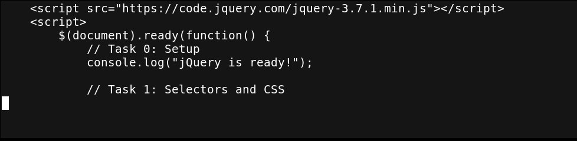
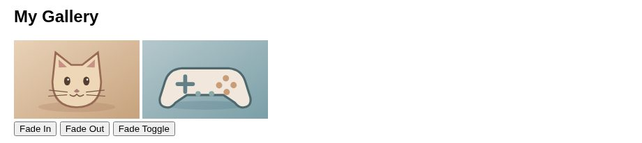
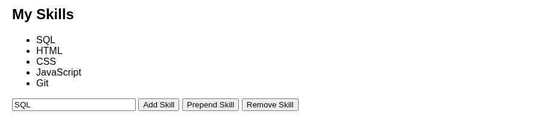
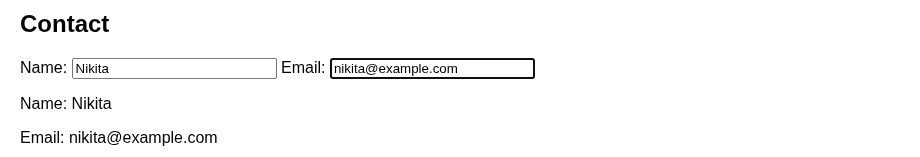
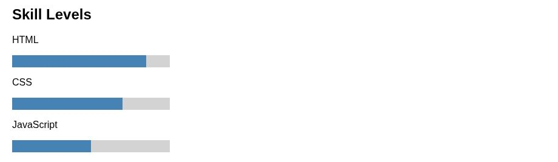

# Assignment #6 — jQuery

**Name:** Nikita Zuy  
**Group:** IT-2501

A simple portfolio made with HTML and jQuery. The small amount of CSS is inside `index.html`.

## Part 1. Getting Started with jQuery

### Task 0. Setup
Included jQuery from a CDN, used `$(document).ready()`, and printed `jQuery is ready!` in the console.

### Task 1. Selectors & CSS
Added a profile, tag/ID/class selectors, `.text()`, `.css()`, and light/dark theme buttons.

## Part 2. jQuery Effects

### Task 2. Visibility Methods
Created an About Me section and used `.hide()`, `.show()`, and `.toggle()`.

### Task 3. Fade Methods
Added two images and buttons using `.fadeIn()`, `.fadeOut()`, and `.fadeToggle()`.

### Task 4. Slide Methods
Added three clickable headings and used `.slideUp()`, `.slideDown()`, and `.slideToggle()`.

## Part 3. DOM Manipulation with jQuery

### Task 5. Add & Remove Elements
Created a list of four skills and used `.append()`, `.prepend()`, and `.remove()`. Empty input is ignored.

### Task 6. Modifying Attributes
Changed a GitHub link to LinkedIn using `.attr()`.

### Task 7. Form Interaction
Displayed Name and Email while typing with `.val()` and `.text()`.

## Part 4. Animations

### Task 8. Basic Animation
Created three skill bars with different widths. `.animate()` shows and hides the bars.

## Work Process Summary
I created the HTML portfolio, added basic CSS for the images and skill bars, and used jQuery for the interactions. I tested the buttons and took screenshots for the report.

## How to Run
Open `index.html` in a browser with internet access. Open the browser console (F12) to check Task 0.

## Submission
Upload all project files to a public GitHub repository, enable GitHub Pages, and submit both links to Moodle. The defense is mandatory.
