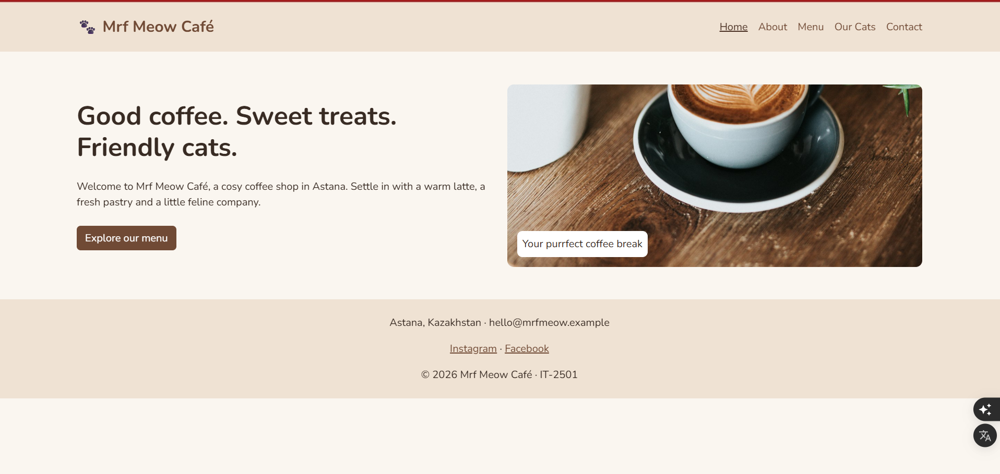
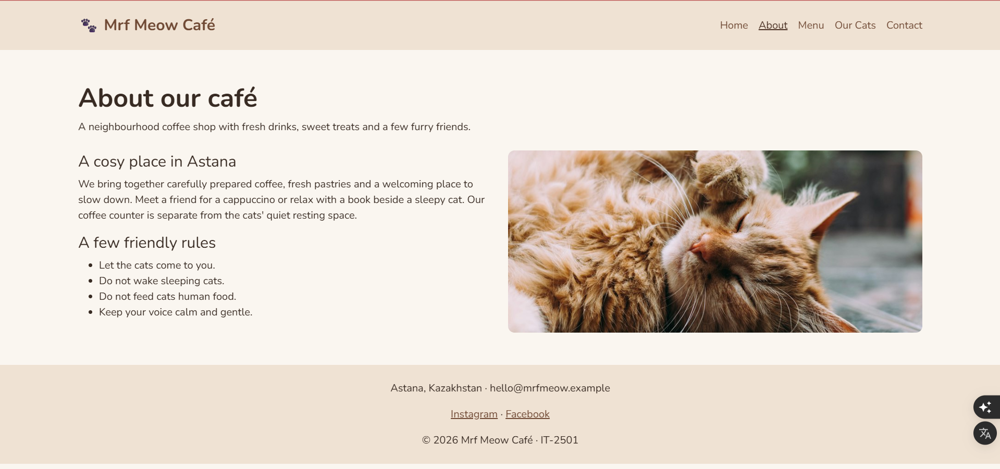
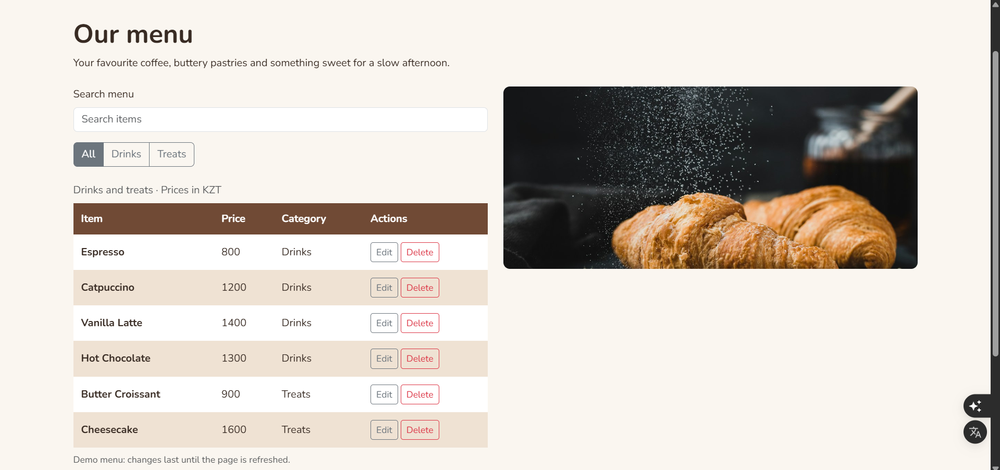
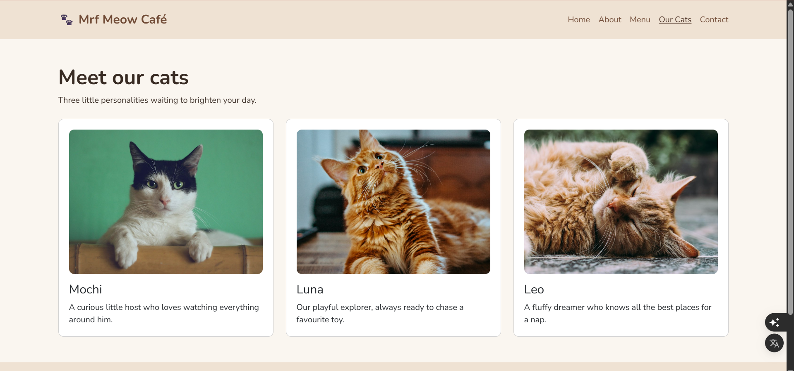
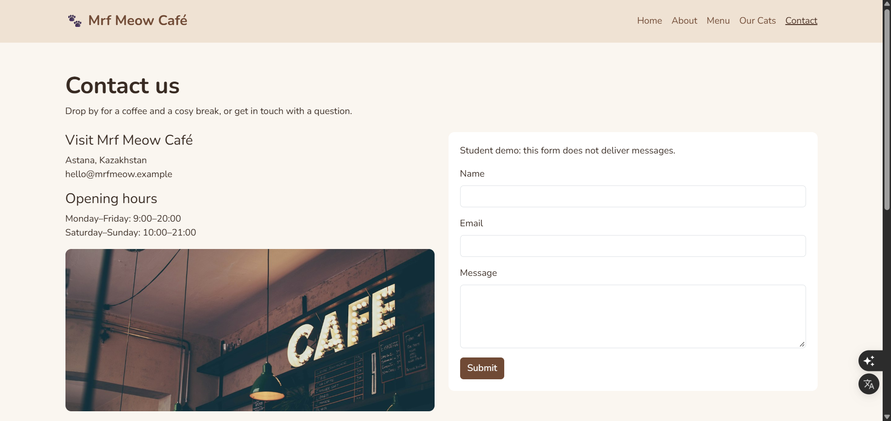
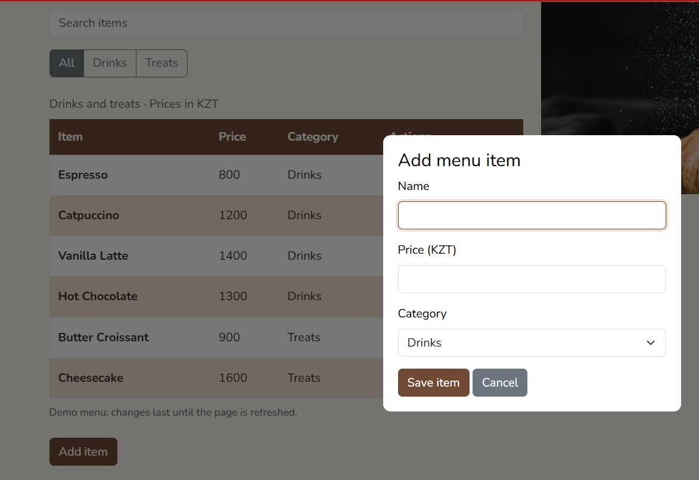
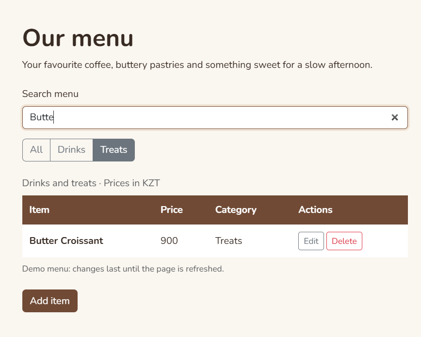

# Mrf Meow Café — Endterm Project

Topic: Cat Café Website  
Group: IT-2501  
Website: https://v01demort.github.io/Endterm/  
Repository: https://github.com/V01demort/V01demort.github.io

## About the project

Mrf Meow Café is a five-page website for a fictional cat café in Astana. We made the first version for Midterm and kept the same design and pages for Endterm. This time, we added JavaScript and jQuery features so visitors can interact with the menu, cat gallery and registration form.

## Features

- Home, About, Menu, Our Cats and Contact pages with a responsive design.
- Registration form with required field checks, email validation using RegEx, password strength indicator, password confirmation and live feedback.
- Live menu search that ignores letter case, plus All, Drinks and Treats category filters.
- Menu table with Add, View, Edit and Delete functions, including a confirmation before deletion.
- Cat gallery with enlarged photos, previous/next buttons and jQuery fade effects.

## Team contributions

| Member | GitHub | Work |
| --- | --- | --- |
| Nikita Zuy | [V01demort](https://github.com/V01demort) | Home and About pages; cat gallery, lightbox, navigation buttons and jQuery fade effects. |
| Aruzhan Abdrakhmanova | [arabdrakh](https://github.com/arabdrakh) | Menu and Our Cats pages; live search, category filters and menu CRUD table. |
| Abbaskhan Ibraimov | [Abbaskhan07](https://github.com/Abbaskhan07) | Contact page; registration form, email and password validation, feedback messages and README. |

## Development steps

1. We continued the Midterm website in the same GitHub repository.
2. We divided the Endterm tasks: menu functions, gallery effects and form validation.
3. We added the new features in JavaScript and jQuery while keeping the original HTML, CSS and Bootstrap layout.
4. We tested the forms, menu and gallery, updated the README and renamed the project folder to Endterm.

## Project files

The Endterm folder contains index.html, about.html, menu.html, gallery.html and contact.html. The css folder contains Bootstrap and style.css, the js folder contains script.js, and the images folder contains the café and cat photos.

## Webpage

